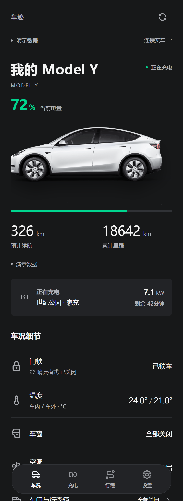
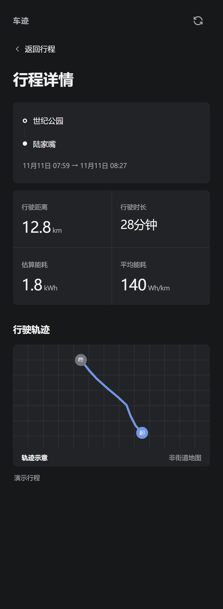
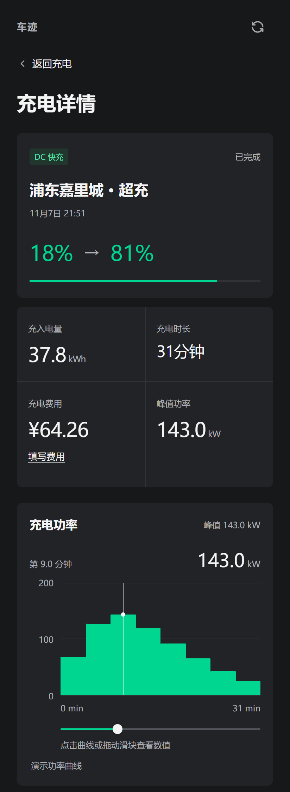

# 车迹 · Tesla Pocket

在鸿蒙、微信小程序和浏览器里查看 Tesla 车况、行程和充电记录。打开即进入演示模式，也可以通过自己的 TeslaMate 服务读取实车数据。


[运行截图](#运行截图) · [快速开始](#快速开始) · [连接实车](#连接实车) · [项目结构](#项目结构)

## 运行截图

以下画面来自本地运行的 H5 1.3.4，使用项目内置的演示数据。

<table>
  <tr>
    <th>车况总览</th>
    <th>行程轨迹</th>
    <th>充电功率</th>
  </tr>
  <tr>
    <td></td>
    <td></td>
    <td></td>
  </tr>
</table>

## 功能

| 功能 | 可查看或操作的内容 |
| --- | --- |
| 车况 | 电量、续航、里程、胎压、门窗、空调和最近上报的位置 |
| 行程 | 按时间筛选记录，查看里程、用时、估算能耗和采样轨迹 |
| 充电 | 查看补能记录、功率曲线和峰值，按总价或电价手动补记本地费用 |
| 原生鸿蒙 | 2.0.0 使用 ArkTS、ArkUI 和 HDS，车况、行程、充电和设置均为原生页面 |
| 数据接入 | 内置演示数据。实车数据由自建 Node.js 服务经 TeslaMateApi 只读获取 |

## 快速开始

安装 Node.js 22.22 或更新版本，在项目根目录运行以下命令。演示模式无需 Tesla 账号或地图密钥。

```bash
npm ci
npm run build:h5
npm run serve
```

打开 [http://127.0.0.1:8776](http://127.0.0.1:8776)，从底部导航进入车况、行程和充电。H5 的构建产物位于 `dist/build/h5/`。

### 鸿蒙应用

用 DevEco Studio 和 API 26 SDK 打开 [harmony/](harmony/)。包名使用示例值 `com.example.teslapocket`，部署时可替换成自己的包名，再配置本地开发签名。构建和签名说明见 [鸿蒙开发文档](harmony/README.md)。

### 微信小程序

将 `src/manifest.json` 中的 `YOUR_WECHAT_APP_ID` 替换为自己的小程序 AppID，运行 `npm run build:mp-weixin`，再用微信开发者工具导入 `dist/build/mp-weixin/`。连接实车时，在微信公众平台将服务的 HTTPS 域名加入小程序的 request 合法域名。

## 连接实车

1. 自建 [TeslaMate](https://github.com/teslamate-org/teslamate) 和兼容的 [TeslaMateApi](https://github.com/tobiasehlert/teslamateapi)，在 TeslaMate 完成车辆授权。
2. 复制 [`.env.example`](.env.example) 为 `.env`。填写 TeslaMateApi 根地址、车辆 ID 和随机生成的访问令牌。可以运行以下命令生成令牌。

   ```bash
   node -e "console.log(require('node:crypto').randomBytes(32).toString('hex'))"
   ```

3. 执行 `npm run serve`。远程或正式访问通过自有 HTTPS 反向代理接入。服务默认只监听本机。
4. 在应用「设置」选择「连接实车」，输入服务根地址和同一个访问令牌。H5 页面与服务地址需同源。

| 环境变量 | 说明 |
| --- | --- |
| `TESLAMATE_API_URL` | TeslaMateApi 的 HTTP(S) 根地址，例如 `http://teslamateapi:8080`。留空进入演示模式 |
| `CAR_ID` | 要读取的车辆 ID，默认为 `1` |
| `APP_ACCESS_TOKEN` | 实车模式必填，至少 32 位，由客户端用 Bearer 认证发送 |
| `UPSTREAM_AUTHORIZATION` | 可选，上游反向代理要求的完整 Authorization 值 |
| `GEOCODER_URL` | 可选，Photon 兼容服务的 HTTPS 根地址。启用后会向该服务发送车辆坐标用于街道解析 |
| `TENCENT_MAP_KEY` / `TENCENT_MAP_SECRET` | 可选，腾讯地图 Web 服务 Key 和签名校验 SK。启用后会向腾讯地图发送行程坐标，用于解析起终点和绘制街道底图 |
| `HOST` / `PORT` | 监听地址和端口，默认 `127.0.0.1:8776` |

真实配置和签名文件保存在本地，地图和上游鉴权凭据仅配置在服务端。客户端读取最近采集的数据，车辆休眠或离线时可能显示缓存。行程与充电列表读取最近 30 天，每类最多 100 条。轨迹、曲线和能耗取决于上游可用的采样。

## 项目结构

| 路径 | 用途 |
| --- | --- |
| `harmony/` | HarmonyOS 2.0.0 原生工程 |
| `src/` | Vue 3 + uni-app 的 H5 / 微信小程序 1.3.4 |
| `server/` | Node.js 只读 API 代理及 H5 静态文件服务 |
| `shared/` | 演示数据与前后端共享类型 |
| `test/` | 数据转换、交互、存储和代理的自动测试 |

```bash
npm run type-check
npm test
```

车迹是独立的个人工具。车辆示意图来自 Tesla，版权归原权利人。Tabler 图标的许可见 [图标目录](src/static/icons/tabler/LICENSE)。地图数据归 © OpenStreetMap contributors，使用条款见 [OpenStreetMap 版权说明](https://www.openstreetmap.org/copyright)。
